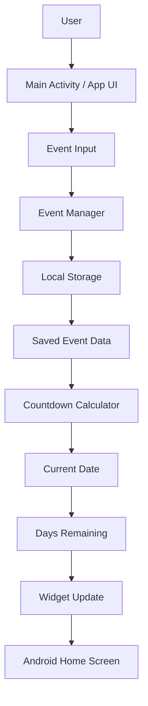
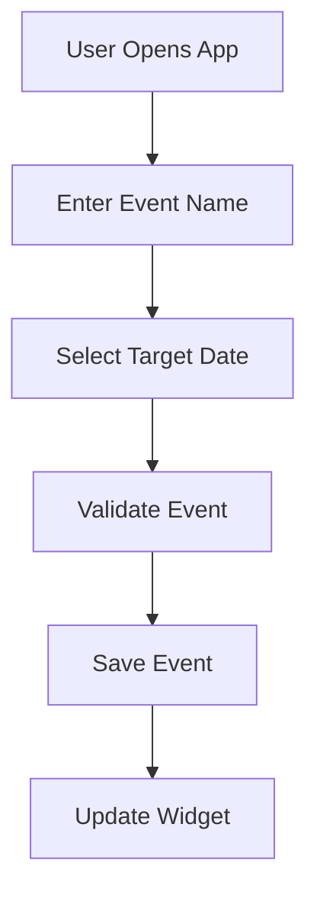
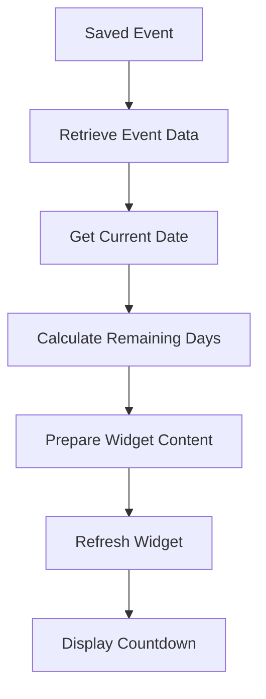

# 📅 DayLeftWidget

**Every day counts. Keep track of the days that matter!**

DayLeftWidget is a lightweight Android home screen widget designed to help users keep track of important upcoming dates, events, and personal milestones.

Whether it is an upcoming birthday, an important deadline, a vacation, or a personal goal, DayLeftWidget makes the countdown visible directly on your home screen.

Instead of repeatedly checking calendars or calculating dates manually, users can see how many days are left at a glance.

## ✨ Features

- 📅 Track important upcoming dates.
- ⏳ Display the remaining days until an event.
- 🏠 Android home screen widget integration.
- 🎯 Keep important milestones visible.
- ⚡ Quick access to countdown information.
- 🎨 Simple and minimal user interface.
- 🔄 Automatically update countdown information.

## 🏗️ Architecture

DayLeftWidget follows a modular widget-oriented architecture that separates the user interface, date calculation logic, data storage, and widget rendering.

### High-Level Architecture



### Architecture Components

**1. User Interface**

Provides the interface for creating and managing countdown events.

**2. Event Manager**

Handles event information such as event names, target dates, and associated details.

**3. Storage Layer**

Maintains saved countdown information locally so events remain available between application sessions.

**4. Countdown Calculator**

Responsible for calculating the number of days remaining between the current date and the selected target date.

**5. Widget Layer**

Displays the countdown information directly on the Android home screen.

## ⚙️ Core Application Logic

### 1. Event Creation



Users create an event by providing its name and target date. The application stores the event information for subsequent countdown calculations.

### 2. Countdown Calculation

The countdown engine calculates the difference between the current date and the target date.

Conceptually:

```text
Target Date - Current Date = Days Remaining
```

For example:

```text
Event: Birthday
Target Date: 30 December 2026
Current Date: 26 November 2026

Days Remaining: 34
```

The application should also handle important date conditions:

- Future dates: Display remaining days.
- Today's date: Display "Today".
- Past dates: Display an appropriate expired or passed status.

### 3. Widget Update Workflow



The widget retrieves the saved event information, calculates the remaining days, and displays the updated result.

## 🧠 Countdown Logic

The calculation should use calendar dates rather than simply dividing elapsed milliseconds by 86,400,000.

This helps avoid incorrect results caused by timezone changes and daylight saving transitions.

Conceptual Kotlin example:

```kotlin
fun calculateDaysRemaining(
    targetDate: LocalDate
): Long {
    val today = LocalDate.now()

    return ChronoUnit.DAYS.between(
        today,
        targetDate
    )
}
```

The returned value can then be used to determine whether the event is upcoming, happening today, or in the past.

## 📂 Project Structure

```text
DayLeftWidget/
├── app/
│   └── src/
│       └── main/
│           ├── java/
│           │   └── com/example/dayleftwidget/
│           │       ├── ui/
│           │       ├── widget/
│           │       ├── data/
│           │       ├── domain/
│           │       └── utils/
│           │
│           ├── res/
│           │   ├── drawable/
│           │   ├── values/
│           │   └── xml/
│           │
│           └── AndroidManifest.xml
│
├── build.gradle.kts
├── settings.gradle.kts
└── README.md
```

*This is a suggested modular structure. Adjust package names and directories to match your actual implementation.*

### Folder Responsibilities

| Directory | Responsibility |
|---|---|
| ui/ | Application screens and UI components |
| widget/ | Android home screen widget implementation |
| data/ | Event storage and data handling |
| domain/ | Countdown calculation and business logic |
| utils/ | Date formatting and helper functions |
| res/ | Application resources |

## 🛠️ Technology Stack

- **Language:** Kotlin (if used in the implementation)
- **Platform:** Android
- **UI:** Jetpack Compose (if applicable)
- **Widget Framework:** Android App Widgets / Jetpack Glance (depending on implementation)
- **Date Handling:** Java Time API
- **IDE:** Android Studio

## 🚀 Getting Started

### Prerequisites

- Android Studio.
- Android SDK.
- Compatible JDK.
- Git.

### Installation

1. Clone the repository.

```bash
git clone YOUR_REPOSITORY_URL
```

2. Open the project in Android Studio.
3. Synchronize Gradle dependencies.
4. Build and install the application.
5. Add DayLeftWidget to your Android home screen.
6. Create your first countdown event.

## 📸 Screenshots

Add screenshots of the application and its home screen widget.

```markdown


```

## 🔮 Future Improvements

- Multiple countdown events.
- Customizable widget designs.
- Event categories.
- Birthday and anniversary reminders.
- Notification support.
- Countdown history.
- Recurring events.
- Personalized themes and backgrounds.

## 🤝 Contributing

Contributions, suggestions, and feature requests are welcome!

Feel free to fork the repository and submit a pull request.

## 📄 License

Add your chosen open-source license if applicable.

---

**Built with ❤️ to make every important day count.**
